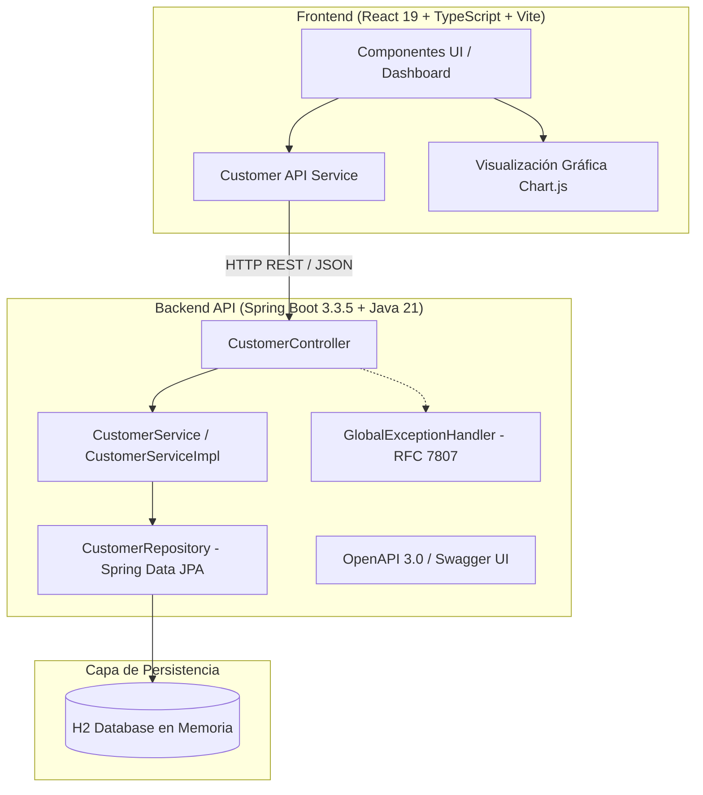

# InDigital XP • Reto Técnico Senior Fullstack Developer

## Sistema de Gestión de Clientes, Auditoría y Análisis Demográfico de Natalidad

<p align="center">
  
  
  
  
  
  
  
  
</p>

Hola y bienvenido. En este repositorio comparto mi desarrollo para la evaluación técnica de **Senior Fullstack Developer** de **InDigital XP**.

Al diseñar esta solución, mi prioridad fue construir un sistema desacoplado, fácil de entender y, sobre todo, **sencillo de ejecutar y evaluar en tu máquina local en menos de dos minutos**. Cuenta con un backend REST en **Spring Boot (Java 21)**, un cliente web interactivo en **React 19 con TypeScript**, datos de prueba precargados, pruebas automatizadas en ambos lados y documentación interactiva vía Swagger.

---

## 📑 Tabla de Contenidos

- [💡 Notas y Decisiones del Desarrollador](#-notas-y-decisiones-del-desarrollador)
- [🏛 Arquitectura del Sistema](#-arquitectura-del-sistema)
- [🛠 Stack Tecnológico](#-stack-tecnológico)
- [📊 Algoritmos de Indicadores Demográficos](#-algoritmos-de-indicadores-demográficos)
- [🔌 Catálogo de Endpoints de la API](#-catálogo-de-endpoints-de-la-api)
- [📖 Documentación Interactiva (Swagger / OpenAPI 3.0)](#-documentación-interactiva-swagger--openapi-30)
- [🚀 Cómo ejecutar el proyecto (Guía para el Evaluador)](#-cómo-ejecutar-el-proyecto-guía-para-el-evaluador)
  - [Opción A: Con Docker Compose (Un solo comando)](#opción-a-con-docker-compose-un-solo-comando)
  - [Opción B: Ejecución Local Nativa (Backend + Frontend)](#opción-b-ejecución-local-nativa-backend--frontend)
- [🧪 Pruebas Automatizadas y Cobertura](#-pruebas-automatizadas-y-cobertura)
- [📮 Colección de Postman](#-colección-de-postman)
- [🔄 Pipeline de CI/CD (GitHub Actions)](#-pipeline-de-cicd-github-actions)
- [👨‍💻 Autor](#-autor)

---

## 💡 Notas y Decisiones del Desarrollador

Antes de entrar en comandos, quiero compartirte brevemente el criterio detrás de las decisiones técnicas:

1. **¿Por qué Java Records en los DTOs?**
   Para garantizar inmutabilidad estricta sin necesidad de plugins o código boilerplate. Los contratos de entrada y salida quedan transparentes y seguros.
2. **¿Por qué calcular la edad al vuelo en lugar de persistirla en base de datos?**
   Guardar la edad en una columna es una trampa clásica de sincronización: con el tiempo queda obsoleta a menos que corras un proceso diario. La persistencia guarda la `fechaNacimiento`, y el DTO calcula la `edad` actual dinámicamente con `Period.between(fechaNacimiento, LocalDate.now())`.
3. **¿Por qué H2 en memoria con datos semilla?**
   Para que como evaluador no tengas que instalar ni configurar PostgreSQL o MySQL para ver todo funcionando. Se incluyen 10 clientes de prueba para que los gráficos y la tabla muestren datos desde el segundo cero. Si se desea usar PostgreSQL en producción, la entidad JPA está lista y basta con configurar las variables de conexión en `application.yml`.
4. **Manejo de errores amigable (RFC 7807):**
   Las APIs no deben devolver páginas de error HTML ni stacktraces crudos. Se configuró un manejador global con `@RestControllerAdvice` que mapea validaciones a `400 Bad Request` y duplicados de DNI/email a `409 Conflict` con mensajes claros en español.
5. **Cálculo de natalidad con precisión decimal:**
   Para las tasas porcentuales se utilizó `BigDecimal` con redondeo `RoundingMode.HALF_UP` a dos decimales. Además, el servicio es resiliente: si no hay clientes registrados, devuelve `0.00%` en lugar de fallar por división entre cero.
6. **Detalle en la exportación a CSV (Microsoft Excel):**
   Cuando exportas texto con tildes o caracteres como la 'ñ' a CSV, Excel en Windows y Mac suele romper la codificación si no detecta el juego de caracteres. Solucioné esto anteponiendo el Byte Order Mark UTF-8 (`\uFEFF`) en la descarga.

---

## 🏛 Arquitectura del Sistema

El proyecto sigue una arquitectura en capas desacoplada con separación clara de responsabilidades:



---

## 🛠 Stack Tecnológico

### Backend
* **Lenguaje:** Java 21 LTS con toolchain.
* **Framework:** Spring Boot 3.3.5 (Spring Web, Spring Data JPA, Spring Validation, Actuator).
* **Gestor de Construcción:** Gradle 9 con Wrapper autónomo (`./gradlew`).
* **Base de Datos:** H2 Database en memoria (con consola web en `/h2-console`).
* **Documentación:** Springdoc OpenAPI 2.6.0 (Swagger UI v3).
* **Pruebas:** JUnit 5, Mockito, Spring MockMvc, AssertJ.
* **Cobertura:** JaCoCo (>88% global, >96% en lógica de servicio).

### Frontend
* **Framework:** React 19 con Hooks y Functional Components.
* **Lenguaje:** TypeScript 5.9 en modo estricto.
* **Tooling:** Vite 8 con Hot Module Replacement instantáneo.
* **Gráficos:** Chart.js con `react-chartjs-2`.
* **Iconos:** Lucide React.
* **Pruebas:** Vitest + React Testing Library (11 tests unitarios).

---

## 📊 Algoritmos de Indicadores Demográficos

El reto solicita cuatro cálculos específicos sobre la fecha de nacimiento de los clientes:

1. **Clientes nacidos por Mes/Año:** Agrupación cronológica por `YearMonth` (`{ year, month, monthName, period, count }`).
2. **Mes/Año con mayor cantidad de nacimientos:** Determina la cohorte con valor máximo ($\max$) y genera una etiqueta amigable (ej: `Mayo 1995 (3 clientes)`).
3. **Mes/Año con menor cantidad de nacimientos:** Determina la cohorte con valor mínimo ($\min$) entre los períodos con registros.
4. **Tasa de Natalidad de cada mes (Enero a Diciembre):**
   $$\text{Tasa Mensual} = \left(\frac{\text{Clientes nacidos en el mes}}{\text{Total de Clientes}}\right) \times 100$$
   Calculado con `BigDecimal` a 2 decimales y protegido contra divisiones por cero.

---

## 🔌 Catálogo de Endpoints de la API

La API responde tanto bajo `/api/v1/customers` como bajo el alias directo `/customers`:

| Método | Endpoint | Descripción | Códigos HTTP |
| :--- | :--- | :--- | :--- |
| `POST` | `/api/v1/customers` | Registrar un nuevo cliente | `201 Created`, `400`, `409` |
| `GET` | `/api/v1/customers` | Listar clientes (soporta filtros `?dni=` y `?email=`) | `200 OK` |
| `GET` | `/api/v1/customers/indicators` | Consultar indicadores demográficos y tasas | `200 OK` |
| `GET` | `/api/v1/customers/{id}` | Consultar detalle de cliente por ID | `200 OK`, `404` |
| `GET` | `/actuator/health` | Healthcheck del servicio | `200 OK` |
| `GET` | `/swagger-ui.html` | Interfaz gráfica de Swagger UI | `200 OK` |

### Ejemplo de Petición (`POST /api/v1/customers`)
```json
{
  "nombre": "Carlos",
  "apellido": "Santana",
  "email": "carlos.santana@example.com",
  "dni": "72849102",
  "fechaNacimiento": "1994-07-15"
}
```

### Ejemplo de Respuesta Exitosa (`201 Created`)
*Header:* `Location: http://localhost:8080/api/v1/customers/1`
```json
{
  "id": 1,
  "nombre": "Carlos",
  "apellido": "Santana",
  "email": "carlos.santana@example.com",
  "dni": "72849102",
  "fechaCreacion": "2026-10-13T19:00:00",
  "fechaNacimiento": "1994-07-15",
  "edad": 32
}
```

---

## 📖 Documentación Interactiva (Swagger / OpenAPI 3.0)

Con el backend levantado, puedes probar todos los endpoints directamente desde tu navegador:

* **Swagger UI:** [http://localhost:8080/swagger-ui.html](http://localhost:8080/swagger-ui.html)
* **OpenAPI Spec JSON:** [http://localhost:8080/v3/api-docs](http://localhost:8080/v3/api-docs)

> **Tip:** El frontend incluye un botón **"Swagger API"** en la barra superior que abre la consola interactiva con un solo clic.

---

## 🚀 Cómo ejecutar el proyecto (Guía para el Evaluador)

Tienes dos formas de ejecutar la solución:

### Opción A: Con Docker Compose (Un solo comando)

Si tienes Docker instalado, es la opción más rápida:

```bash
# 1. Clonar el repositorio
git clone https://github.com/JordyMontalvo/reto-tecnico.git
cd reto-tecnico

# 2. Levantar la aplicación completa
docker compose up --build
```

* **Frontend:** [http://localhost:3000](http://localhost:3000)
* **Backend API:** [http://localhost:8080](http://localhost:8080)
* **Swagger UI:** [http://localhost:8080/swagger-ui.html](http://localhost:8080/swagger-ui.html)

---

### Opción B: Ejecución Local Nativa (Backend + Frontend)

Si prefieres correrlo en tu terminal directamente:

#### 1. Iniciar el Backend (Spring Boot)
Requiere Java 17 o 21 instalado:
```bash
cd backend
./gradlew bootRun
```
El servicio estará listo en `http://localhost:8080`.

#### 2. Iniciar el Frontend (React + Vite)
En otra terminal, requiere Node.js 18+ o 20+:
```bash
cd frontend
npm install
npm run dev
```
La aplicación abrirá en [http://localhost:5173](http://localhost:5173) (o `5174` si el puerto anterior estuviera ocupado).

---

## 🧪 Pruebas Automatizadas y Cobertura

### Backend (22 pruebas unitarias e integración)
```bash
cd backend
./gradlew test jacocoTestReport
```
* **Lógica de Servicio (`CustomerServiceImpl`):** **96%** de cobertura.
* **Capa DTOs & Records:** **100%** de cobertura.
* **Capa Controladores (`CustomerController`):** **82%** de cobertura.
* **Cobertura Total:** **88%** (reporte disponible en `backend/build/reports/jacoco/test/html/index.html`).

### Frontend (11 pruebas con Vitest)
```bash
cd frontend
npm test
```
Cubre validaciones de formulario, formateo de fechas, cálculo de edad y cliente HTTP de API.

---

## 📮 Colección de Postman

En la carpeta `postman/` encontrarás dos archivos listos para importar:
* `postman/Customers_API.postman_collection.json`
* `postman/Customers_Local.postman_environment.json`

Incluye pruebas para creación exitosa, validaciones de DNI, detección de duplicados (`409 Conflict`), filtros de búsqueda e indicadores demográficos.

---

## 🔄 Pipeline de CI/CD (GitHub Actions)

El repositorio cuenta con integración continua automatizada en `.github/workflows/ci.yml`. En cada `push` a la rama `master`:
1. Compila el microservicio en Java 21, ejecuta los 22 tests y valida JaCoCo.
2. Valida los tipos en TypeScript, ejecuta los 11 tests de Vitest y compila el bundle de producción en Node 22.

---

## 👨‍💻 Autor

* **Jordy Montalvo Alfaro**  
  *Senior Fullstack Developer*  
  [jordyjosephmontalvo@gmail.com](mailto:jordyjosephmontalvo@gmail.com) • [GitHub: @JordyMontalvo](https://github.com/JordyMontalvo)