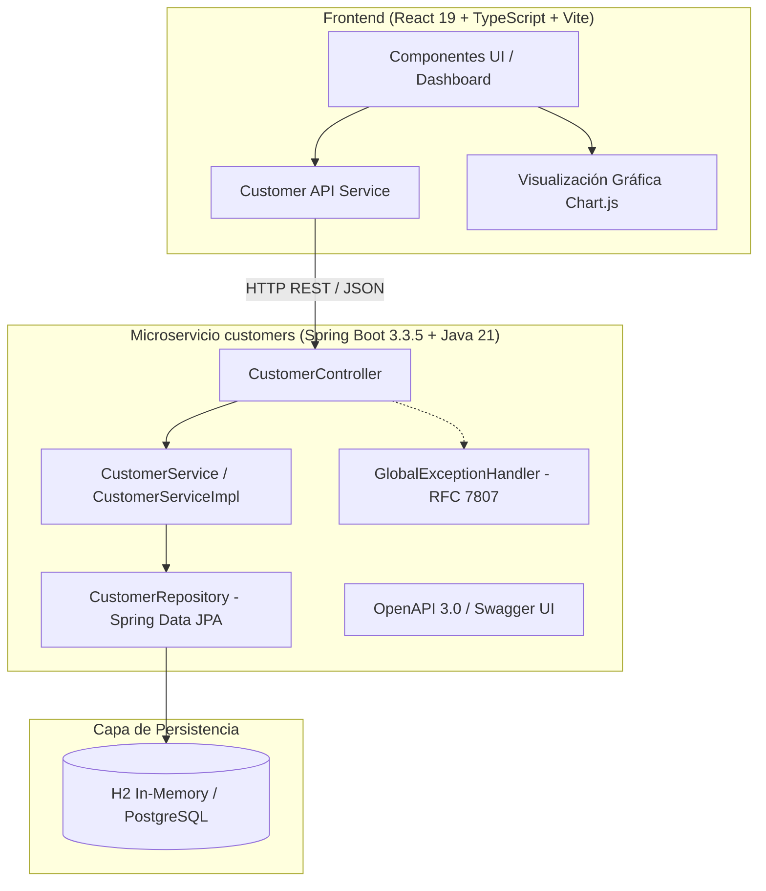

# InDigital XP • [Reto 004] Senior Fullstack Developer
## Sistema de Gestión de Clientes, Auditoría y Análisis Demográfico de Natalidad

Solución integral desarrollada para la evaluación técnica de **Senior Fullstack Developer** de **InDigital XP**. La solución implementa un microservicio backend robusto en **Spring Boot (Java 21)** gestionado por **Gradle** y una aplicación frontend moderna en **React con TypeScript** gestionada por **npm / Vite**, cubriendo el 100% de los requerimientos funcionales, técnicos y no funcionales evaluados con estándares de nivel enterprise.

---

## 📑 Tabla de Contenidos
- [InDigital XP • \[Reto 004\] Senior Fullstack Developer](#indigital-xp--reto-004-senior-fullstack-developer)
  - [Sistema de Gestión de Clientes, Auditoría y Análisis Demográfico de Natalidad](#sistema-de-gestión-de-clientes-auditoría-y-análisis-demográfico-de-natalidad)
  - [📑 Tabla de Contenidos](#-tabla-de-contenidos)
  - [🏛 Arquitectura del Sistema](#-arquitectura-del-sistema)
  - [🛠 Stack Tecnológico](#-stack-tecnológico)
    - [Backend](#backend)
    - [Frontend](#frontend)
    - [DevOps \& Contenedores](#devops--contenedores)
  - [📊 Algoritmos de Indicadores y Tasa de Natalidad](#-algoritmos-de-indicadores-y-tasa-de-natalidad)
  - [🔌 Catálogo de Endpoints de la API](#-catálogo-de-endpoints-de-la-api)
    - [Ejemplo de Request para Crear Cliente (`POST /api/v1/customers`)](#ejemplo-de-request-para-crear-cliente-post-apiv1customers)
    - [Ejemplo de Respuesta Exitosa (`201 Created`)](#ejemplo-de-respuesta-exitosa-201-created)
  - [📖 Documentación Interactiva (Swagger / OpenAPI)](#-documentación-interactiva-swagger--openapi)
  - [🚀 Instrucciones de Instalación y Ejecución](#-instrucciones-de-instalación-y-ejecución)
    - [Opción 1: Despliegue con Docker Compose (Recomendado)](#opción-1-despliegue-con-docker-compose-recomendado)
    - [Opción 2: Ejecución Local Nativa (Backend + Frontend)](#opción-2-ejecución-local-nativa-backend--frontend)
      - [Requisitos Previos:](#requisitos-previos)
      - [1. Iniciar el Backend (Spring Boot)](#1-iniciar-el-backend-spring-boot)
      - [2. Iniciar el Frontend (React + Vite)](#2-iniciar-el-frontend-react--vite)
  - [🧪 Pruebas Automatizadas y Cobertura de Código](#-pruebas-automatizadas-y-cobertura-de-código)
    - [Pruebas de Backend (Spring Boot + JUnit 5 + Mockito)](#pruebas-de-backend-spring-boot--junit-5--mockito)
    - [Pruebas de Frontend (Vitest + Testing Library)](#pruebas-de-frontend-vitest--testing-library)
  - [📮 Colección de Postman](#-colección-de-postman)
    - [Casos de Prueba Incluidos en Postman:](#casos-de-prueba-incluidos-en-postman)
  - [🛡 Decisiones de Diseño y Manejo de Casos Borde](#-decisiones-de-diseño-y-manejo-de-casos-borde)
  - [🔄 Pipeline de CI/CD (GitHub Actions)](#-pipeline-de-cicd-github-actions)
  - [👨‍💻 Autor](#-autor)

---

## 🏛 Arquitectura del Sistema

La solución sigue principios de **Clean Code**, **SOLID**, **Inmutabilidad** (mediante Java Records en capas de transferencia) y una **Arquitectura en Capas desacoplada**:



---

## 🛠 Stack Tecnológico

### Backend
- **Lenguaje:** Java 21 (LTS).
- **Framework:** Spring Boot 3.3.5 (Spring MVC, Spring Data JPA, Spring Validation, Actuator).
- **Gestor de Construcción:** Gradle 9.x con Wrapper autónomo (`./gradlew`).
- **Base de Datos:** H2 Database en memoria (con consola web habilitada) y compatibilidad para PostgreSQL.
- **Documentación API:** Springdoc OpenAPI 3.0 (Swagger UI v2.6.0).
- **Testing:** JUnit 5, Mockito, AssertJ, Spring Test MockMvc.
- **Cobertura:** JaCoCo (>88% de cobertura en lógica de negocio y controladores).

### Frontend
- **Framework:** React 19 con TypeScript estricto.
- **Build Tool:** Vite 8 (Hot Module Replacement instantáneo).
- **Visualización de Datos:** Chart.js + react-chartjs-2.
- **Iconografía:** Lucide React.
- **Testing:** Vitest + React Testing Library + @testing-library/jest-dom (11 tests unitarios).

### DevOps & Contenedores
- **Docker:** Multi-stage builds optimizados con imágenes oficiales Eclipse Temurin y Node/Nginx Alpine.
- **Docker Compose:** Orquestación con healthchecks de servicio.
- **CI/CD:** GitHub Actions workflow automatizado.

---

## 📊 Algoritmos de Indicadores y Tasa de Natalidad

El PDF del requerimiento solicita:
1. **Cantidad de clientes nacidos por mes/año**:
   - Agrupación cronológica por `YearMonth` de la fecha de nacimiento.
   - Retorna: `{ year, month, monthName, period (YYYY-MM), count }`.
2. **Mes/Año con mayor cantidad de clientes nacidos**:
   - Determina la cohorte con valor máximo ($\max$). En caso de empate, prioriza el período más reciente y genera una etiqueta amigable (ej: `Mayo 1995 (3 clientes)`).
3. **Mes/Año con menor cantidad de clientes nacidos**:
   - Determina la cohorte con valor mínimo ($\min$) entre los períodos con registros existentes.
4. **Tasa de Natalidad de cada mes (Enero a Diciembre)**:
   - Para cada uno de los 12 meses del calendario gregoriano ($m \in [1, 12]$):
     $$\text{Tasa}(m) = \left( \frac{\sum \text{Clientes nacidos en mes } m}{\text{Total general de clientes}} \right) \times 100\%$$
   - Redondeo a 2 decimales usando `BigDecimal` con `RoundingMode.HALF_UP`.
   - **Resiliencia ante base de datos vacía:** Si el total es 0, la tasa retorna `0.00%` para todos los meses, evitando excepciones de división por cero o `NullPointerException`.

---

## 🔌 Catálogo de Endpoints de la API

La API expone endpoints duales: tanto bajo `/api/v1/customers` como bajo el alias directo `/customers`:

| Método | Endpoint | Descripción | Códigos HTTP |
| :--- | :--- | :--- | :--- |
| `POST` | `/api/v1/customers` | Registrar un nuevo cliente | `201 Created`, `400 Bad Request`, `409 Conflict` |
| `GET` | `/api/v1/customers` | Listar clientes (sin filtros o con `?dni=` y/o `?email=`) | `200 OK` |
| `GET` | `/api/v1/customers/indicators` | Consultar indicadores demográficos y tasa de natalidad | `200 OK` |
| `GET` | `/api/v1/customers/{id}` | Consultar detalle de cliente por ID | `200 OK`, `404 Not Found` |
| `GET` | `/actuator/health` | Healthcheck de estado del servicio | `200 OK` |
| `GET` | `/swagger-ui.html` | Interfaz interactiva de Swagger UI | `200 OK` |
| `GET` | `/h2-console` | Consola interactiva de base de datos H2 | `200 OK` |

### Ejemplo de Request para Crear Cliente (`POST /api/v1/customers`)
```json
{
  "nombre": "Carlos",
  "apellido": "Santana",
  "email": "carlos.santana@example.com",
  "dni": "72849102",
  "fechaNacimiento": "1994-07-15"
}
```

### Ejemplo de Respuesta Exitosa (`201 Created`)
*Header:* `Location: http://localhost:8080/api/v1/customers/1`
```json
{
  "id": 1,
  "nombre": "Carlos",
  "apellido": "Santana",
  "email": "carlos.santana@example.com",
  "dni": "72849102",
  "fechaCreacion": "2026-10-13T19:00:00",
  "fechaNacimiento": "1994-07-15",
  "edad": 32
}
```

---

## 📖 Documentación Interactiva (Swagger / OpenAPI)

Una vez iniciado el backend, accede a la documentación interactiva OpenAPI v3:
- **Swagger UI:** [http://localhost:8080/swagger-ui.html](http://localhost:8080/swagger-ui.html)
- **OpenAPI JSON Spec:** [http://localhost:8080/v3/api-docs](http://localhost:8080/v3/api-docs)

Permite ejecutar solicitudes en vivo, probar validaciones y revisar esquemas DTO.

---

## 🚀 Instrucciones de Instalación y Ejecución

### Opción 1: Despliegue con Docker Compose (Recomendado)

Requisitos: Tener instalado [Docker](https://www.docker.com/) y Docker Compose.

```bash
# 1. Clonar el repositorio
git clone <url-del-repositorio>
cd reto-tecnico

# 2. Levantar toda la solución (Backend + Frontend + Nginx)
docker compose up --build
```

- **Frontend:** [http://localhost:3000](http://localhost:3000) o [http://localhost:80](http://localhost:80)
- **Backend API:** [http://localhost:8080](http://localhost:8080)
- **Swagger UI:** [http://localhost:8080/swagger-ui.html](http://localhost:8080/swagger-ui.html)

---

### Opción 2: Ejecución Local Nativa (Backend + Frontend)

#### Requisitos Previos:
- **JDK 17 o 21** instalado (`java -version`).
- **Node.js v18+ o v20+** instalado (`node -v`).

#### 1. Iniciar el Backend (Spring Boot)
```bash
cd backend

# Ejecutar con el wrapper de Gradle
./gradlew bootRun
```
El backend iniciará en el puerto `8080`. Se cargan automáticamente 10 clientes semilla de demostración para visualización inmediata en los gráficos.

#### 2. Iniciar el Frontend (React + Vite)
En una nueva terminal:
```bash
cd frontend

# Instalar dependencias
npm install

# Iniciar servidor de desarrollo
npm run dev
```
La aplicación abrirá en [http://localhost:5173](http://localhost:5173).

---

## 🧪 Pruebas Automatizadas y Cobertura de Código

### Pruebas de Backend (Spring Boot + JUnit 5 + Mockito)
Se implementaron 22 pruebas automatizadas cubriendo:
- Validaciones de negocio (DNI de 8 dígitos, unicidad de correo, fechas futuras).
- Controladores MockMvc con cabeceras `Location` y mapeo de errores HTTP (`400`, `404`, `409`).
- Algoritmos de cálculo de indicadores con precisión decimal y casos borde.
- Repositorio JPA y filtros personalizados.

Para ejecutar los tests y generar el reporte de cobertura JaCoCo:
```bash
cd backend
./gradlew test jacocoTestReport
```

**Resultados de Cobertura JaCoCo:**
- **Lógica de Servicio (`CustomerServiceImpl`):** **96%**
- **Capa DTO & Requests:** **100%**
- **Capa Controladores (`CustomerController`):** **82%**
- **Cobertura Total del Microservicio:** **88%**
- El reporte HTML detallado se genera en: `backend/build/reports/jacoco/test/html/index.html`.

### Pruebas de Frontend (Vitest + Testing Library)
Se implementaron 11 pruebas unitarias cubriendo:
- Validación en tiempo real del formulario modal (DNI 8 dígitos, regex email, fechas).
- Renderizado de la tabla de clientes, estados de carga y empty states.
- Servicio HTTP de consumo de API y manejo de errores con `ApiError`.

Para ejecutar los tests del frontend:
```bash
cd frontend
npm test
```

---

## 📮 Colección de Postman

Se incluye la colección oficial de Postman lista para importar en:
- `postman/Customers_API.postman_collection.json`
- `postman/Customers_Local.postman_environment.json`

### Casos de Prueba Incluidos en Postman:
1. `POST Crear Cliente (Exitoso)`: Valida status `201`, existencia de cabecera `Location` y cuerpo del cliente.
2. `POST Crear Cliente (DNI Inválido)`: Valida status `400` y mensaje explicativo del campo `dni`.
3. `POST Crear Cliente (DNI Duplicado)`: Valida status `409 Conflict`.
4. `GET Listar Clientes`: Valida status `200` y array de resultados.
5. `GET Filtrar por DNI`: Valida coincidencia del filtro.
6. `GET Filtrar por Email`: Valida consulta por correo.
7. `GET Consultar Indicadores`: Valida estructura demográfica y tasas porcentuales de 12 meses.
8. `GET Endpoint Dual (/customers)`: Valida soporte sin prefijo de versión.

---

## 🛡 Decisiones de Diseño y Manejo de Casos Borde

1. **Normalización y Sanitización:**
   - Todo DNI recibido se limpia de caracteres no numéricos y espacios.
   - El correo electrónico se normaliza a minúsculas (`toLowerCase(Locale.ROOT)`).
2. **Control Centralizado de Excepciones:**
   - Implementación de `@RestControllerAdvice` retornando objetos estructurados consistentes con RFC 7807 (`timestamp`, `status`, `error`, `message`, `path`, `validationErrors`).
   - Mapeo transparente de violaciones de unicidad a `409 Conflict`.
3. **Cálculo de Edad Dinámico:**
   - La entidad almacena `fechaNacimiento`, y el DTO de respuesta calcula dinámicamente la `edad` actual mediante `java.time.Period`.
4. **Consola H2 Disponible:**
   - Accesible en `/h2-console` (JDBC URL: `jdbc:h2:mem:customersdb`, Usuario: `sa`, Contraseña vacía).
5. **UI Reactiva & Accesible:**
   - Notificaciones tipo toast flotantes sin bloqueo de interfaz.
   - Gráficos reactivos con Chart.js con tooltips informativos.
   - Filtros de búsqueda instantánea con opción de restablecimiento.

---

## 🔄 Pipeline de CI/CD (GitHub Actions)

El archivo `.github/workflows/ci.yml` ejecuta automáticamente en cada `push` o `pull request`:
1. Compilación de Spring Boot y ejecución de suite de tests en Java 21 con generación de artefactos JaCoCo.
2. Validación de tipos TypeScript, ejecución de suite Vitest y compilación de producción en Node 22.

---

## 👨‍💻 Autor

- **Jordy Montalvo Alfaro**  
  *Desarrollador Full Stack Senior*  
  [jordyjosephmontalvo@gmail.com](mailto:jordyjosephmontalvo@gmail.com) • [GitHub](https://github.com/jordyjoseph)
1